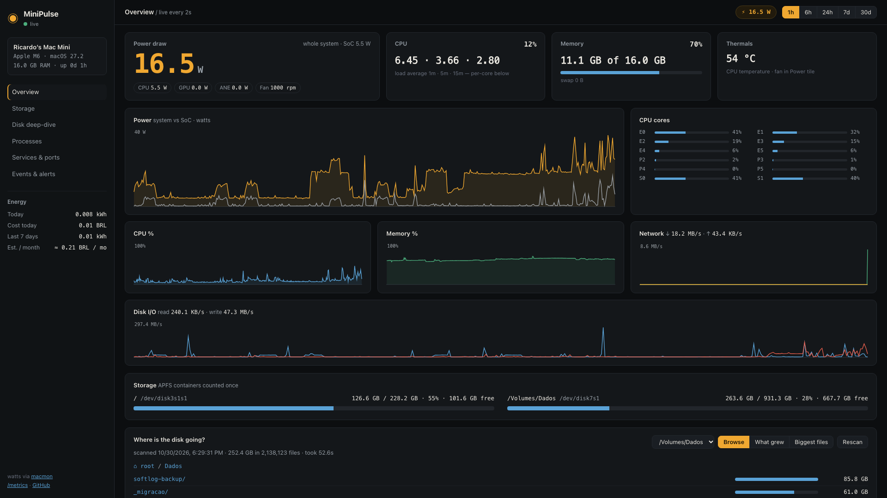
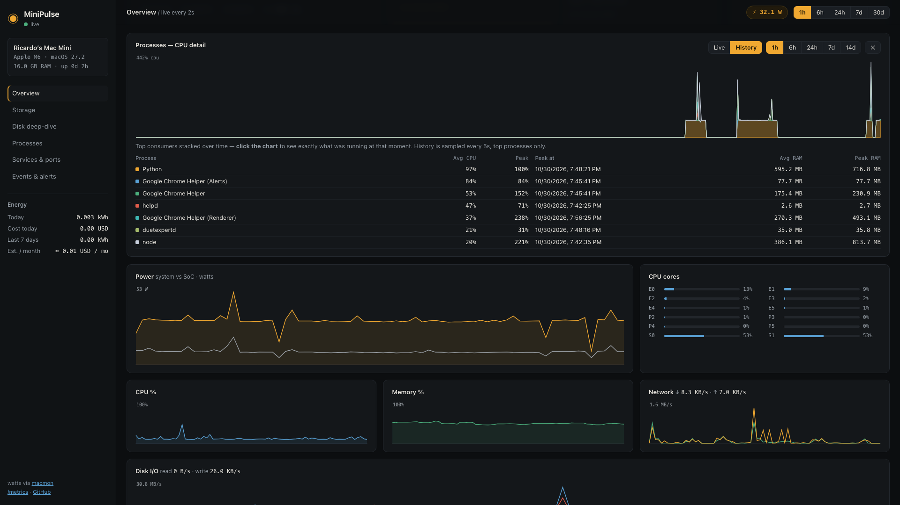
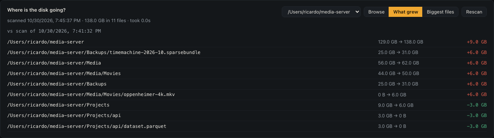
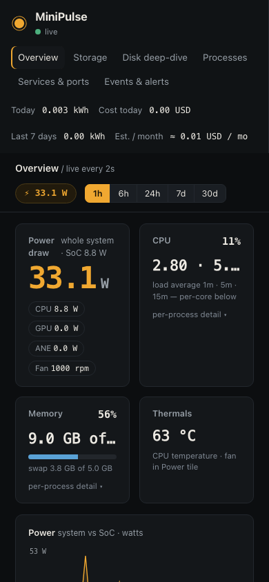
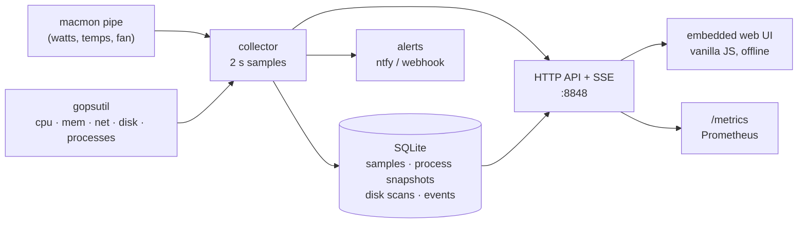

<p align="center">
  <h1 align="center">MiniPulse</h1>
  <p align="center"><strong>The heartbeat of your Mac.</strong><br>
  A tiny (“mini”) always-on web dashboard for any Apple Silicon Mac — mini, MacBook, iMac or Studio —<br>
  whether it runs 24/7 as a home server or it is simply the Mac you use every day:<br>
  live watts &amp; energy cost, CPU/RAM history, the processes behind them, and where your disk is going.</p>
  <p align="center">
    <a href="https://github.com/ricardotech/minipulse/actions/workflows/ci.yml"></a>
    <a href="https://github.com/ricardotech/minipulse/releases"></a>
    <a href="https://github.com/ricardotech/minipulse/blob/main/LICENSE"></a>
    
    
  </p>
</p>



## Quick start

**Requirements:** an Apple Silicon Mac, macOS 13+, and [macmon](https://github.com/vladkens/macmon) for the live wattage (everything else works without it).

```sh
brew install macmon
go install github.com/ricardotech/minipulse/cmd/minipulse@latest
minipulse service install   # launchd: starts at login, restarts on crash
```

Open **http://127.0.0.1:8848**. That's it — no accounts, no cloud, no sudo.

No Go toolchain? Download a tarball from [Releases](https://github.com/ricardotech/minipulse/releases); from the next release on, each ships a `.sha256` file so you can check the download isn't corrupted (`cd` to the download folder, then `shasum -a 256 -c minipulse-<version>-darwin-<arch>.tar.gz.sha256` — an integrity check, not a signature). MiniPulse is not code-signed (yet), so after extracting, clear the quarantine flag once: `xattr -d com.apple.quarantine ./minipulse`. Prefer not to? `go install` above builds from source and skips quarantine entirely.

## Why?

A base-model Mac mini is now the home server of choice: ~5 W idle, silent, and fast enough for Plex, Home Assistant, Docker stacks and local LLMs. But monitoring one is surprisingly awkward:

- **Menu-bar tools** (Stats, iStat Menus) are great on a desktop, but a server mini runs *headless* — nobody is logged in to see a menu bar. Their remote modes stream your metrics to a third-party cloud.
- **Generic server dashboards** (Glances, Netdata, Beszel, node_exporter) don't know Apple Silicon exists: no watts, no Neural Engine, no E/P cores, nothing temperature.
- **Power** is the #1 question mini-server owners ask ("what does 24/7 cost me?") and most answer it with a smart plug, because software either needs `sudo powermetrics` or keeps no history.
- **Storage** is the #2 pain: the base mini has 256 GB, and macOS answers "what's eating it?" with a grey *System Data* bar of 100 GB+. Caches, Docker images, Ollama models and AI tools grow silently until the disk is full at 3 a.m.

MiniPulse is built for exactly that machine: a headless mini you want to watch from your laptop or phone, over your own network, with history and alerts — and nothing leaving the house. The landscape survey behind these choices, exact same-name aggregation semantics included, is in [docs/RESEARCH.md](docs/RESEARCH.md).

**Not just for servers.** The same questions hit an everyday MacBook or iMac: *why is the fan spinning and the battery draining — which process, and since when?* (process history + spike events) and *my disk filled up again — which cache grew, Xcode's DerivedData, Docker images, a browser cache, an Ollama model?* (the "what grew" diff). MiniPulse is **read-only** towards your data: it tells you what and where, and never deletes your files — you stay in charge of the cleanup. On a laptop, consider `disk_scan_interval_minutes: 0` (scan on demand from the dashboard) so a full home-directory walk never competes with your battery.

## Features

- ⚡ **Live watts without sudo** — whole-system + CPU/GPU/ANE power, temperatures, fan, and per-core E/P/S activity, via [macmon](https://github.com/vladkens/macmon)'s `pipe` mode (the same IOReport data `powermetrics` uses, unprivileged).
- 🔌 **Energy & cost accounting** — kWh today, 7 days, month; cost in your currency at your tariff; average and peak draw; optional CO₂. The cumulative counter survives restarts.
- 🧩 **Processes behind the percentages** — click the CPU or Memory card for a detail drawer: live top processes with bars, plus a *History* tab with an area chart of the top consumers over time, leader boards (average/peak, and *when* the peak happened), and click-the-chart snapshots — "what was eating the machine at 14:03?". Instances that share a name (e.g. all Chrome helpers) are summed. CPU % is per-core: 100% = one full core.
- 📜 **A light consumption log** — top consumers sampled every 30 s (kept 14 days by default), plus automatic *process spike* events when something pins 2+ cores. Everything in one local SQLite file.
- 💾 **Where is the disk going?** — scheduled scans of any roots: browse biggest-first, see **what grew since the last scan**, and the biggest files overall.
- 🐳 **Containers & services** — Docker Desktop / OrbStack / Colima containers, launchd jobs, listening TCP ports, and HTTP health checks.





- 🔔 **Alerts without a cloud** — disk %, CPU temperature, RAM, power draw and failed health checks to an [ntfy](https://ntfy.sh) topic or any webhook; sustained per-process CPU spikes are logged as events. Cooldowns included; there is no vendor account and no telemetry.
- 🔒 **Private by design** — binds `127.0.0.1` by default and *refuses* to listen on a LAN address without a token. CSP/nosniff/frame headers, owner-only data dir, token via `minipulse token`. See [SECURITY.md](SECURITY.md) for the threat model.
- 📈 **History & Prometheus** — every sample stored locally (samples 30 days by default); a Prometheus endpoint at `/metrics` composes with your existing Grafana instead of replacing it.
- 🪶 **Small** — one Go binary, an embedded vanilla-JS UI (no build step, works offline), ~20 MB RAM and ~0.3% CPU idle on the author's mini.

<p align="center"></p>

## How MiniPulse compares

| | MiniPulse | Stats | macmon | Beszel / Glances |
|---|---|---|---|---|
| Form | headless daemon + web UI | menu-bar app | terminal UI / JSON | web dashboard |
| Apple Silicon watts, no sudo | ✅ (via macmon) | ✅ | ✅ | ❌ |
| Energy cost over time | ✅ | ❌ | ❌ | ❌ |
| Works with nobody logged in | ✅ | ❌ GUI session | partial | ✅ |
| Per-process history (who ate CPU at 14:03) | ✅ | ❌ | live list only | limited |
| Disk growth diff ("what grew") | ✅ | ❌ | ❌ | usage only |
| Containers / launchd / ports | ✅ | ❌ | ❌ | containers only |
| Your metrics leave the house | never | remote mode: vendor cloud | never | self-hosted |

MiniPulse is deliberately *not* a menu-bar app, fan controller, or multi-OS fleet manager — neighbours do those better. It is the one box above, watched well.

## Windows

MiniPulse also runs on Windows 10/11 and Windows Server (amd64) — same dashboard, same API, for the mini-PC or server box that happens to run Windows. Download the `-windows-amd64.zip` from [Releases](https://github.com/ricardotech/minipulse/releases) (from the next release on), or build with `go build` (CGO + a MinGW gcc for the SQLite driver), then, from an **Administrator** terminal:

```powershell
.\minipulse.exe service install   # Windows Service: auto-start, restart on crash
```

Open **http://127.0.0.1:8848**. Config/data/logs for the service live in `%ProgramData%\minipulse\`; running in the foreground they live in `%APPDATA%\minipulse` / `%LOCALAPPDATA%\minipulse`.

What differs from macOS:

- **No watts/temperatures.** Windows has no sudoless package-power source (MSR/RAPL needs a kernel driver and admin), so the power tile reports unavailable; everything else (CPU/RAM/process history, disk deep-dive, services + listening ports, Docker via named pipe, health checks, alerts, Prometheus) works.
- **The service runs as LocalSystem** by default so it can see every user's processes and scan every home directory (the macOS agent runs as *you*). If you prefer least privilege, change the service's log-on account in `services.msc` to a regular user — it will then only see what that user sees. See [SECURITY.md](SECURITY.md).
- Services list shows *running* Windows services (the full list runs to hundreds of stopped entries).

## See it from your phone (Tailscale)

Keep MiniPulse on loopback and publish it only inside your tailnet:

```sh
tailscale serve --bg 8848
# → https://<your-mini>.<tailnet>.ts.net
```

For a plain LAN bind instead, generate a token first (`minipulse token`), put it in the config, then open the dashboard once with `?token=…` (it becomes a cookie). MiniPulse refuses to start on a non-loopback address with no token unless you pass `--insecure-no-auth`.

## Configuration

Optional — the defaults work out of the box. Generate a file with `minipulse init-config` (written to `~/.config/minipulse/config.json`, mode `0600`).

| Field | Default | Meaning |
|---|---|---|
| `addr` | `127.0.0.1:8848` | listen address |
| `token` | *(none)* | API token (required off-loopback) |
| `sample_interval_seconds` | `2` | metrics cadence |
| `retention_days` | `30` | sample history kept |
| `process_sample_interval_seconds` | `30` | top-process snapshot cadence (`0` disables history) |
| `process_top_n` | `10` | per ranking kept per snapshot (CPU ∪ RAM) |
| `process_retention_days` | `14` | process history kept |
| `alert_process_cpu_pct` | `200` | log a spike event above this % sustained |
| `energy_price_per_kwh` / `currency` | `0.15` / `USD` | your electricity tariff |
| `grid_co2_per_kwh` | `0` | set to show CO₂ estimates |
| `disk_scan_roots` | `["~"]` | directories to walk (add `/Volumes/…`, `/Applications`) |
| `disk_scan_interval_minutes` | `60` | scan cadence (`0` = on demand only) |
| `disk_min_entry_bytes` | `10485760` | smaller entries are aggregated, not stored |
| `health_checks` | `[]` | `[{name, url, expect_status?}]`, polled every 30 s |
| `alert_disk_pct` / `alert_cpu_temp_c` / `alert_mem_pct` / `alert_watts` | `85` / `95` / `92` / `0` | thresholds (`0` disables) |
| `alert_webhook_url` | *(none)* | ntfy topic URL or generic webhook |
| `alert_cooldown_minutes` | `30` | repeat interval while a rule keeps firing |

Data lives in `~/.local/share/minipulse/` (owner-only). On the author's mini — 2 s samples, process snapshots every 30 s, disk scans of home + a 1 TB SSD — the database sits in the tens of MB.

## CLI

```sh
minipulse                      # serve in the foreground
minipulse service install|uninstall|status
minipulse scan [--top 25] [paths…]   # one-off disk scan, biggest first
minipulse token                # print a random API token
minipulse init-config
minipulse version
```

Logs from the launchd service land in `~/Library/Logs/minipulse/`.

## HTTP API

Everything the UI shows, as JSON, plus a live SSE stream:

| Endpoint | What |
|---|---|
| `GET /api/overview` | host info + latest sample + energy today |
| `GET /api/stream` | SSE — one event per sample, server-paced |
| `GET /api/history?range=1h\|6h\|24h\|7d\|30d` | bucketed system history |
| `GET /api/processes?sort=mem\|cpu&limit=15` | live top processes (CPU % per core: 100 = 1 core) |
| `GET /api/processes/history?range=&sort=&limit=` | leaders + stacked series |
| `GET /api/processes/at?ts=<unix\|RFC3339>` | stored snapshot nearest that moment |
| `GET /api/energy?range=today\|7d\|month` | kWh, cost, avg/peak, per-day |
| `GET /api/disk?root=&view=tree\|growth\|biggest&parent=` | disk deep-dive |
| `POST /api/disk/scan` | trigger a rescan |
| `GET /api/containers` · `GET /api/services` · `GET /api/events` | Docker, launchd+ports+health, event log |
| `GET /metrics` · `GET /healthz` | Prometheus text · liveness |

## How watts work without sudo

`powermetrics` requires root — a non-starter for an always-on agent. [macmon](https://github.com/vladkens/macmon) reads the same underlying IOReport data through a private but unprivileged API. MiniPulse runs `macmon pipe` as a child process and parses its JSON stream; if macmon isn't installed, one line on the dashboard says so and everything else still works.

Per-process CPU, like `ps`, is computed by diffing cumulative CPU time between process walks — a true current rate. A process seen for the first time that was born since the previous walk reports its since-birth average, so a stacked peak during heavy short-lived process churn (compilers, CI helpers) can briefly overstate the instantaneous total.

## Architecture



## FAQ

**Does it work on Intel Macs?** The dashboard runs, but Apple Silicon is the point: no watts/ANE/tiers on Intel (macmon is Apple Silicon-only).

**A process shows 250% CPU. Bug?** No — CPU % is per core, like `top`: 100% is one full core, so a multi-threaded app on a 12-core mini can reach 1200%. In History, instances sharing a name are summed ("all of Chrome").

**Process History is empty right after install.** Expected: snapshots land every 30 s by default, so the first points appear within a minute and the window fills as time passes. Set `process_sample_interval_seconds` lower if you want denser history (it costs a process walk per sample).

**How much disk does the history take?** Roughly: system samples every 2 s ≈ a few MB/week, process snapshots every 30 s ≈ 3–5 MB/day before the 14-day retention prune, and disk-scan entries depend on your roots (entries under 10 MiB aren't stored). The author's full database is ~30 MB.

**Does MiniPulse phone home?** Never. The only outbound calls are health checks and alert webhooks that *you* configure. The UI is embedded and works fully offline.

**How do I uninstall?** `minipulse service uninstall`, delete the binary, `~/.local/share/minipulse/`, `~/.config/minipulse/` and `~/Library/Logs/minipulse/`. On Windows: `minipulse.exe service uninstall` (Administrator), delete the `.exe`, `%ProgramData%\minipulse\` (service mode) and `%APPDATA%\minipulse` / `%LOCALAPPDATA%\minipulse` (foreground mode).

**Why not use Beszel/Netdata/Grafana?** They're good at fleets and generic infrastructure. None of them knows what a Mac's SoC is doing, what your electricity costs, or which folder grew 40 GB last night. MiniPulse also exposes `/metrics`, so they compose.

**Does MiniPulse clean or delete anything?** Never touches your data files. It is a read-only observer of your data: nothing of yours is moved, emptied or deleted, and the only state-changing API call is "rescan the disk now". (It manages only its own files: config, the launchd plist from `service install`, logs, and its local SQLite database, whose old rows it prunes.) When the disk view points at a 30 GB cache, deleting it (or not) is your call — see [SECURITY.md](SECURITY.md) for the full threat model.

**Will the disk scans hurt my SSD or battery?** A scan is a metadata walk (names and sizes, symlink-safe), the same reads `du` makes — no writes to your files. It does cost CPU while it runs, so on a laptop set `disk_scan_interval_minutes: 0` (from the next release on, then not even the boot-time catch-up scan runs) and rescan on demand; on an always-plugged-in Mac the hourly default is fine. Restarts don't trigger a redundant rescan while every root's last scan is still fresh.

## Development

```sh
make check   # gofmt + vet + tests
make build   # ./minipulse
make run     # build & serve on :8848
```

The codebase is deliberately boring: stdlib HTTP, one metrics library (gopsutil), one SQLite driver, zero build step for the UI (three static files via `go:embed`). Package layout and ground rules in [CONTRIBUTING.md](CONTRIBUTING.md); security model and reporting in [SECURITY.md](SECURITY.md); version history in [CHANGELOG.md](CHANGELOG.md).

## Roadmap ideas (PRs welcome)

- SSD health / TBW (SMART) on the storage card
- Known-cache labels in the disk view ("Xcode DerivedData — safe to delete, Xcode rebuilds it") so personal-Mac users can act on a finding without researching every folder first
- Signed & notarized release binaries
- Homebrew tap formula
- Multi-Mac fleet view (several Macs, one page)
- Per-process energy impact, now that process history exists

## Credits & license

MIT — see [LICENSE](LICENSE). Built on [macmon](https://github.com/vladkens/macmon) (MIT) for wattage, [gopsutil](https://github.com/shirou/gopsutil) (BSD-3-Clause) for system metrics, and [mattn/go-sqlite3](https://github.com/mattn/go-sqlite3) (MIT).

If MiniPulse saved you from a full disk at 3 a.m., a ⭐ helps other Mac owners find it.

